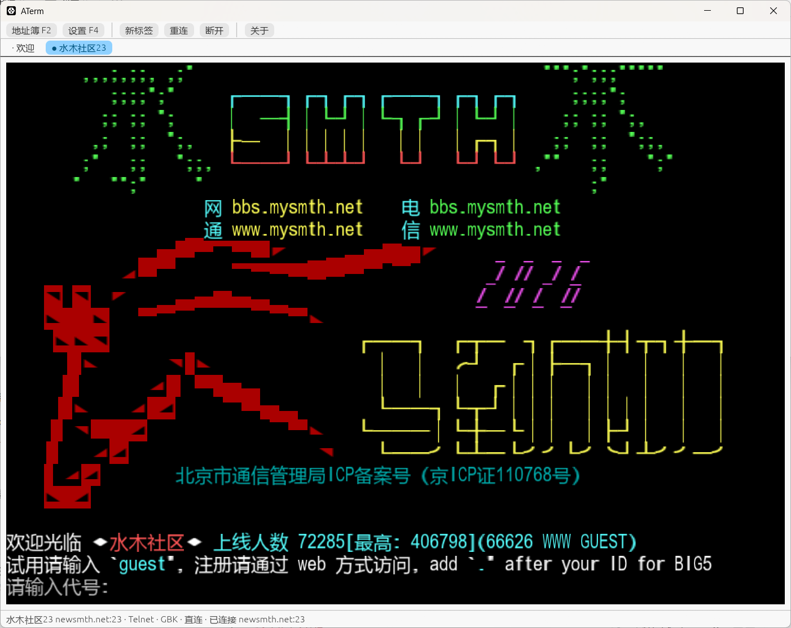
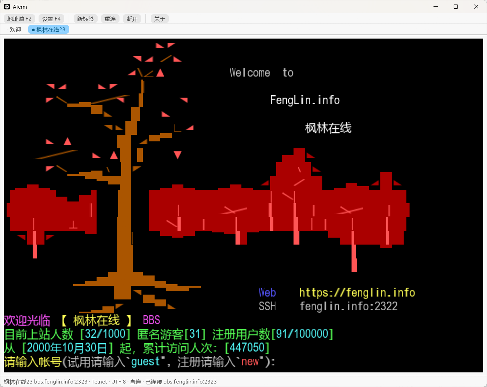
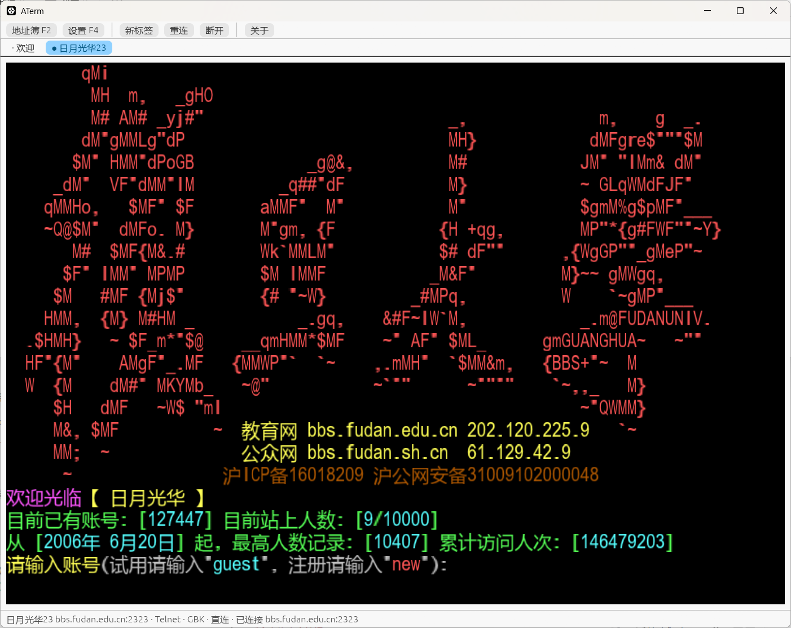

# ATerm

面向传统 BBS 的 Telnet / SSH 终端客户端，用 Rust 编写。纯 Rust 图形界面（egui/eframe，OpenGL 渲染），单文件 exe，无需安装运行时，不依赖 Qt。

A classic Telnet/SSH terminal client for traditional BBS, written in Rust.







## 功能

| 类别 | 说明 |
|---|---|
| 协议 | Telnet（IAC 选项协商）、SSH（russh，password + keyboard-interactive 认证） |
| 代理 | SOCKS5，支持用户名/密码认证；Telnet 与 SSH 均可走代理 |
| 编码 | GBK / Big5 / UTF-8 / ISO-8859-1，增量解码，运行时可切换 |
| 简繁转换 | 每站点可选 GB→Big5 / Big5→GB 输入内码转换，OpenCC 单字表逐字映射 |
| 终端仿真 | VT100/xterm 子集：ANSI 16/256/真彩色、粗体/下划线/反显、光标形状、滚动区域、备用屏幕、OSC 标题、宽字符 |
| 中文输入 | 直接用系统输入法，候选窗跟随光标 |
| 复制粘贴 | 鼠标划选复制，快捷键粘贴；Ctrl+C/X/V 直发 BBS |
| 防掉线 | 每站点可设心跳内容与间隔，有键输入时自动暂停 |
| 按键宏 | 自定义触发键发送内容，Ctrl+Shift+M 全局开关 |
| 自动登录 | 按提示符匹配顺序发送账号/密码/附加命令 |
| 多标签 | 多站点并行，右键标签关闭/属性，断线重连 |
| 地址簿 | 分组管理、站点编辑，内置水木社区、枫林在线、日月光华、PTT 等常用站点 |

## 下载

前往 [Releases](../../releases) 页面下载最新的 `aterm-vX.Y.Z-windows-x64.exe`，双击即可运行。

配置文件 `config.json` 保存在 exe 同目录（便携设计，首次保存时自动生成）。

## 构建

需要 Rust（MSVC 工具链，Windows x64）：

```bash
cargo build --release
cargo test
```

产物位于 `target/release/aterm.exe`。SSH 加密使用纯 Rust 的 `ring` 后端，无需 CMake/NASM；图形使用 glow（OpenGL）后端。

推送 `v*` 标签会触发 GitHub Actions 自动编译并发布 Release（见 `.github/workflows/release.yml`）。

## 快捷键

- `Ctrl+Insert` 复制 · `Shift+Insert` 粘贴
- 滚轮上/下 = 向 BBS 发送 PgUp/PgDn
- `Ctrl+Shift+R` 断线重连 · `Ctrl+Shift+W` 关闭标签
- `Ctrl+Shift+M` 按键宏全局开关

## 其他
- 第一次鼠标悬浮于IP地址时，会从远程下载IP数据库，用于显示IP所在地
- 地址簿中改名保存会添加新地址，沿用了FTerm的特性
